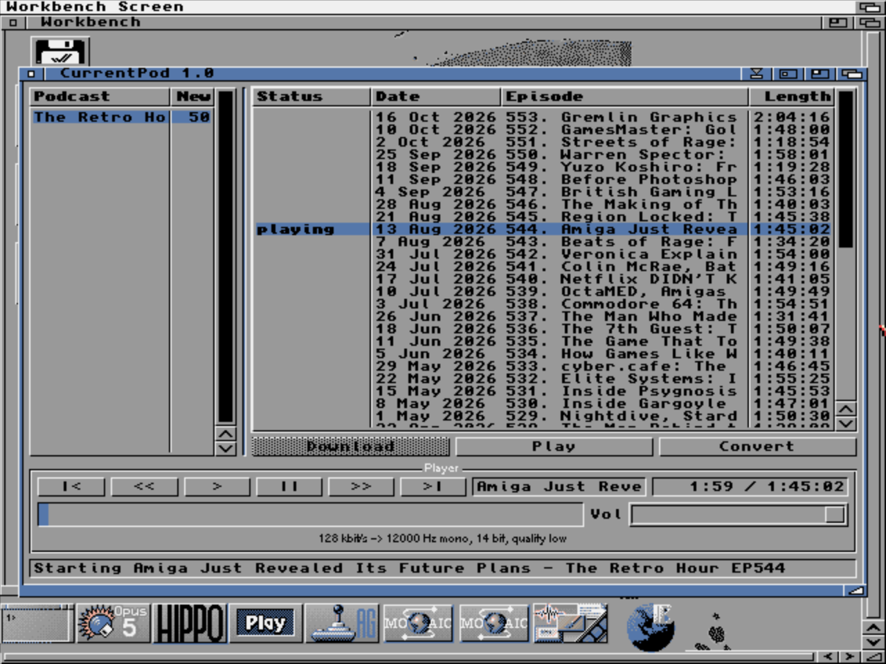
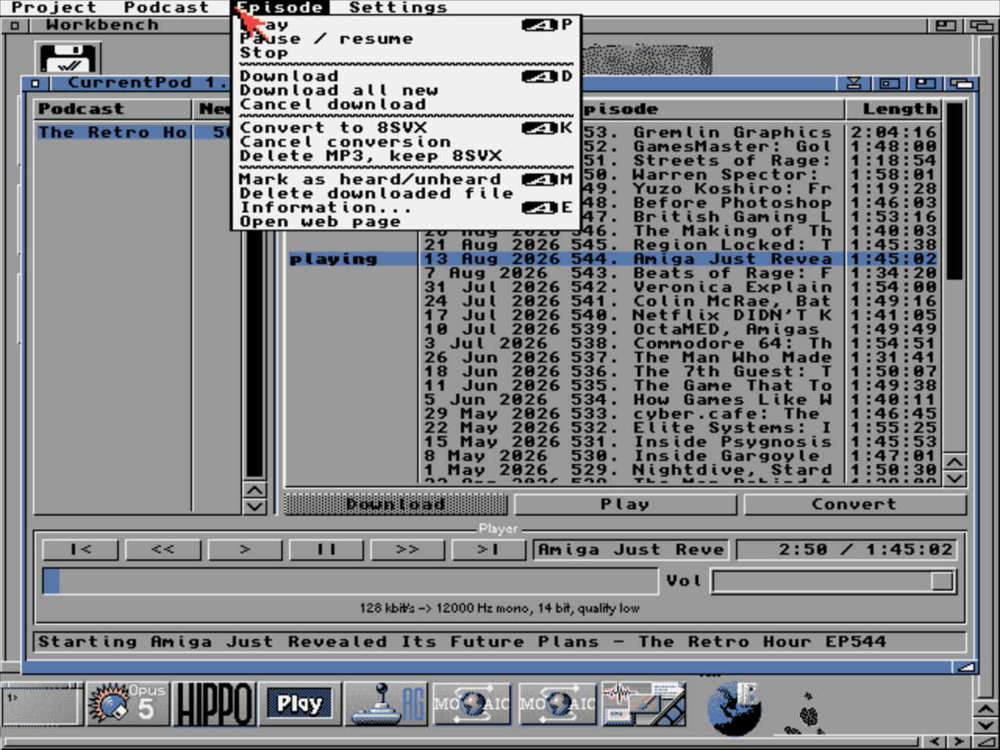
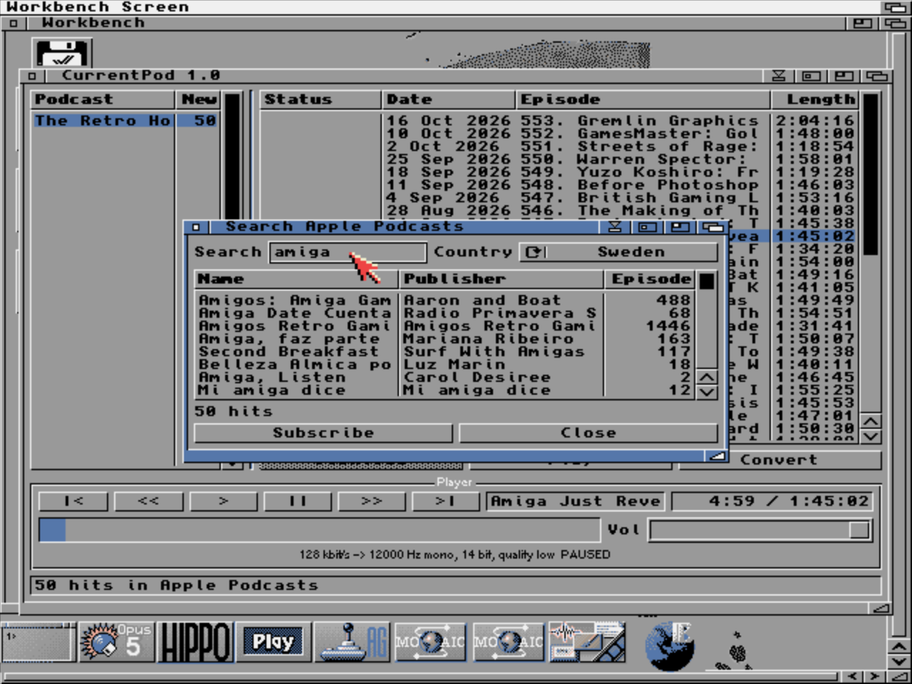

# CurrentPod

**Your Amiga is a podcast player now.**

CurrentPod is a podcast client for AmigaOS 3.x with a proper MUI interface.
Search the Apple Podcasts catalog, subscribe, download episodes over HTTPS
and listen to them straight out of Paula, on a Workbench that looks like it
is 1997. It is 2026, the podcasts are about the Amiga, and the Amiga plays
them. That is a nice loop.



## What it does

- **Finds podcasts.** Search the Apple Podcasts catalog from inside the
  program, in the country of your choice, and subscribe with one click.
  No Apple ID needed.
- **Takes any feed.** Paste an RSS or Atom address, or a
  `podcasts.apple.com` link, and CurrentPod digs out the real feed by itself.
- **Downloads over HTTPS.** AmiSSL does the encryption. If the connection
  drops halfway through a 100 MB episode, CurrentPod picks up where it left
  off with HTTP Range requests, as many times as it takes.
- **Plays MP3 through Paula.** Decoding is done by Stéphane Tavenard's
  mpega.library from 1998, which still does the job. Output is 14-bit audio
  using the paired-channel trick, so speech sounds clean.
- **Converts to IFF 8SVX.** Machine too slow for MP3? Press Convert and
  CurrentPod turns the episode into a plain 8SVX file in the background.
  After that, playback is disk-to-Paula with no decoding at all. Any Amiga
  can do that.
- **Remembers where you were.** Stop in the middle of an interview and
  continue next week.
- **Speaks your language.** English by default, Swedish included through
  locale.library, and room for more catalogs.
- **Comes with a real manual.** An AmigaGuide manual in English and Swedish,
  readable in MultiView.

## The workflow

Pick an episode and press **Download**. When it is on disk, **Play** and
**Convert** light up. Play starts the MP3 right away. Convert makes an 8SVX
copy, and from then on Play uses that. The status column tells you what is
going on: `new`, `fetching 34%`, `downloaded`, `conv. 37%`, `playing`.





## Requirements

- AmigaOS 3.0 or later (Kickstart 39+)
- A 68020 or better, 2 MB fast RAM, 1 MB free chip RAM
  (a 68030 at 50 MHz with FPU or faster is recommended for MP3)
- MUI 3.8 or later
- A TCP/IP stack with bsdsocket.library: AmiTCP, Miami, Genesis or Roadshow
- AmiSSL 4.x or 5.x for HTTPS, which nearly every podcast host requires
- mpega.library 2.0 or later in `LIBS:` for MP3 playback

## How fast is it?

MP3 layer III decoding is the heavy part. CurrentPod has four quality levels
and picks the best one the machine can keep up with. For speech, mono at
11-12 kHz or 22-24 kHz sounds perfectly fine.

Measured with The Retro Hour (128 kbit/s, 48 kHz) in an emulated A1200,
throttled to classic speeds. The figures are CPU time as a share of real
time, so anything under 100 % plays without gaps.

| Machine                   | 24 kHz mono | 12 kHz mono | 24 kHz stereo |
|---------------------------|-------------|-------------|---------------|
| A1200 with 68030 and FPU  | 160 %       | 78 %        | -             |
| A1200 with 68060          | 80 %        | -           | 125 %         |

So a 68030 plays podcasts in 12 kHz mono, and a 68060 handles 24 kHz.
Anything slower converts to 8SVX first and plays that.

Downloads are limited by TLS decryption, not by the disk. CurrentPod asks
for ChaCha20 first, which a 68030 decrypts about three times faster than
AES, and falls back to AES when a server says no. On the 68030 that is
roughly 34 kB/s, or about an hour for a long episode. Start the download
and go make a coffee. Or a lasagna.

## Installing

Make a drawer anywhere you like, for example `Work:Internet/CurrentPod`,
and put these in it:

```
CurrentPod                              the program (give it any tool icon)
CurrentPod.guide                        the manual in English
CurrentPod_svenska.guide                the manual in Swedish
Catalogs/svenska/CurrentPod.catalog     the Swedish translation
```

CurrentPod creates `Feeds/` (the database, plain text) and `Episodes/`
(downloaded files, one drawer per podcast) next to itself on first start.
Settings are tooltypes and a menu. `DOWNLOADDIR=` moves the episodes to a
bigger partition, and `LANGUAGE=svenska` forces the Swedish catalog. The
manual lists the rest.

## Building

CurrentPod is written in C and cross-compiled on Linux with
[bebbo's amiga-gcc](https://github.com/AmigaPorts/m68k-amigaos-gcc)
(gcc 6.5, libnix). Besides the toolchain you need `lha`, `iconv`,
Python 3 and three SDK archives:

| Archive                          | Where to get it                   |
|----------------------------------|-----------------------------------|
| `MUI-3.9-2015R1-os3.lha`         | the MUI 3.9 release, includes SDK |
| `AmiSSL-5.27-SDK.lha`            | the AmiSSL releases on GitHub     |
| `mpega_library.lha`              | Aminet, `util/libs`               |

Unpack them into `sdk/` at the top of the repository:

```bash
mkdir sdk && cd sdk
lha xw=MUI-3.9-2015R1-os3 /path/to/MUI-3.9-2015R1-os3.lha
lha xw=AmiSSL-5.27-SDK /path/to/AmiSSL-5.27-SDK.lha
lha x /path/to/mpega_library.lha
```

Then build:

```bash
cd src
make TC=/opt/amiga
```

`TC` is the toolchain prefix. `X=` points somewhere other than `sdk/`, and
`MPEGA=` does the same for mpega.library alone. The result lands in
`build/`: the program and `catalogs/svenska/CurrentPod.catalog`.
`tools/mkcatalog.py` turns `CurrentPod.cd` and the `.ct` translations into
`strings.h` and the binary catalog.

The sources and the manuals in `docs/` are UTF-8 on disk. The Makefile
converts the sources to Latin-1 before compiling, so the strings look right
on Workbench. Convert the manuals the same way before copying them over:

```bash
iconv -f UTF-8 -t ISO-8859-1 docs/CurrentPod.guide > CurrentPod.guide
```

Code comments and the debug log are in Swedish, because that is where
CurrentPod was born.

### Adding a translation

Copy `src/catalogs/svenska.ct`, translate the strings, and add a rule for it
in the Makefile next to the Swedish one. The catalog goes in
`Catalogs/<language>/CurrentPod.catalog`. Pull requests with new languages
are very welcome.

## Good to know

- TLS 1.3 hangs AmiSSL under the FS-UAE bsdsocket emulation, so CurrentPod
  sticks to TLS 1.2. That is fine for every podcast host tested so far.
- FFS allows at most 30 characters in a file name. CurrentPod shortens
  episode file names to fit.
- Only MP3 episodes can be played. AAC and M4A episodes can be downloaded,
  but there is no usable AAC decoder for the 68k.
- Searching the catalog while an MP3 is playing on a 68030 can make the TLS
  handshake time out. Pause, search, and press play again.

## Thanks

- Stefan Stuntz for MUI
- Stéphane Tavenard for mpega.library
- Jens Maus and the AmiSSL team for AmiSSL
- Stefan "Bebbo" Franke for gcc for m68k-amigaos
- Krzysztof Radzikowski and George Sokianos for showing that podcasts on
  the Amiga can be done (AMIcast Player, MediaVault)
- The Retro Hour, the test podcast that never complained

## License

CurrentPod is free to use and distribute. It comes as is: the author is not
responsible for a full hard disk, or for what the podcasts say.

Apple, Apple Podcasts and iTunes are trademarks of Apple Inc. CurrentPod is
not endorsed by, affiliated with or otherwise connected to Apple.
